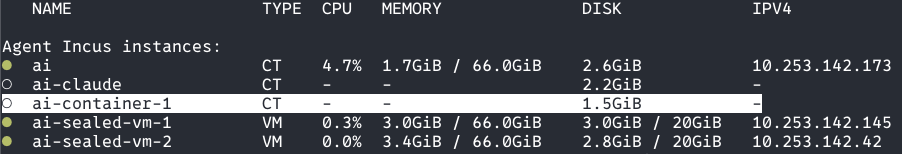
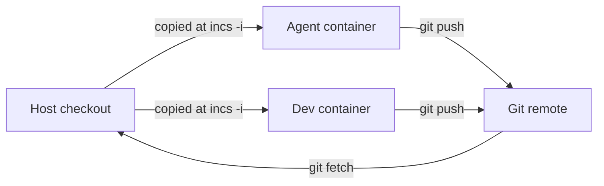

# AgentIncus

A set of shell scripts that automate the creation of [Incus](https://linuxcontainers.org/incus/) containers and VMs for coding agents, including Claude Code, Codex, and Grok Build. See COI's [Why Incus](https://github.com/mensfeld/code-on-incus?tab=readme-ov-file#why-incus-over-docker) for why Incus over Docker.

Why shell scripts? They introduce no dependencies, are ergonomic enough for simple systems administration tasks, and transparently convey their purpose.

## Contents

- [Prerequisites](#prerequisites)
- [Install](#install)
- [Quick Start](#quick-start)
- [Scripts](#scripts)
- [incus.init Options](#incusinit-options)
  - [What incus.init does](#what-incusinit-does)
  - [Coding Agents](#coding-agents)
  - [Optional Plugins](#optional-plugins)
- [The Development Workflow](#the-development-workflow)
  - [Getting work out](#getting-work-out)
  - [Daily Flow with tmux](#daily-flow-with-tmux)
  - [Templates](#templates)
  - [Virtual Machines](#virtual-machines)
  - [Tailscale](#tailscale)
  - [Expose Container Ports](#expose-container-ports)
  - [Snapshots](#snapshots)
  - [Network Isolation](#network-isolation)
  - [Egress Allowlist](#egress-allowlist)
- [Runtime Management](#runtime-management)
- [Linux Gotchas](#linux-gotchas)

## Prerequisites

- **Linux**: [Incus](https://linuxcontainers.org/incus/docs/main/installing/) installed and initialized (`incus admin init`)
- **macOS**: [Homebrew](https://brew.sh/) installed — `incus.init` will automatically prompt to install Colima and the Incus CLI, then bootstrap a Colima VM with the Incus runtime
- `~/.local/bin` in your `PATH`
- `jq` — only for `incs status` (preinstalled on macOS 15+; `sudo apt install jq` on Ubuntu)

## Install

```bash
git clone <repo-url> agent_incus
cd agent_incus
./install_shortcuts
```

This symlinks the helper scripts into `~/.local/bin`.

It then offers to install [Chadmux](https://github.com/chadfennell/chadmux), Chad's tmux config, on your host (see [Daily Flow with tmux](#daily-flow-with-tmux)). The answer defaults to no. The question only appears when your host has no tmux config: an existing `~/.tmux.conf`, `~/.config/tmux`, or `$XDG_CONFIG_HOME/tmux` is never moved, replaced, or linked over. Pass `--chadmux` or `--no-chadmux` to decide without the prompt, and re-run `./install_shortcuts` to opt in later. Chadmux needs `git` and `tmux` on the host.

## Quick Start

```bash
# Create a container with a copy of the current directory in /workspace.
# Choose an agent; all three share the same instance setup
incs -i my-project --agent claude
# Or: incs -i my-project --agent codex
# Or: incs -i my-project --agent grok

# Open a shell
incs my-project

# Start the selected agent
incs my-project claude
# Or: incs my-project codex
# Or: incs my-project grok
```

## Scripts

| Script | Alias | Purpose |
|---|---|---|
| `incs` | — | Unified CLI (shell, init, network, update, status) |
| `incus.init` | `inci` | Create and provision a container |
| `incus.shell` | — | Open a login shell (or run a command) in a container |
| `incus.network` | `incn` | Manage port proxy devices |
| `incus.macos.setup` | — | Bootstrap Colima + Incus on macOS (called automatically by `incus.init`) |
| `incs.new-plugin` | — | Scaffold a new plugin file from a template (also `incs new-plugin`) |
| `install_shortcuts` | — | Symlink helpers and aliases into `~/.local/bin`; optionally install Chadmux on the host |
| `chadmux.host` | — | Install Chadmux on the host (called by `install_shortcuts`) |

### incs — Unified CLI

`incs` is the main entrypoint. It routes to the underlying scripts:

```bash
incs my-project                        # Shell into container (default)
incs -s my-project                     # Shell (explicit)
incs -s my-project mix test            # Run a command in container
incs -s my-project "mix test | tail"   # One quoted string runs as a shell line
incs -i my-project                     # Create a new container
incs -i my-project --from base-dev     # Create from template
incs -n my-project 4000 3241           # Proxy ports 4000 and 3241 to localhost
incs -n my-project 4000:8080           # Host 4000 -> container 8080
incs -n my-project -b 10.0.0.5 4000   # Proxy on a specific address (e.g. Tailscale IP for remote access)
incs -n my-project -l                  # List active proxies
incs -n my-project -r 4000            # Remove proxy for port 4000
incs -n my-project -r all             # Remove all proxies
incs -u my-project                     # Update packages in a container
incs -ua                               # Update all agent-incus containers
incs                                   # Live view of all instances (same as incs status)
incs status                            # Live view of all instances; space starts/stops one
incs status --once                     # Print the status table once
incs -d my-project                     # Delete a container
incs cron install                      # Install 7pm daily update cron
incs cron install 3                    # Install 3am daily update cron
incs cron status                       # Show current cron schedule
incs cron remove                       # Remove the update cron
```

The individual scripts and aliases (`inci`, `incn`) still work directly.

`incs status` lists every instance with its state, type, CPU, memory, disk, and IPv4 addresses. Instances created by `incus.init` appear first under "Agent Incus instances", and everything else follows under "Other Incus instances". Running instances are marked `●`, frozen `◐`, and stopped `○`, and the type column reads `CT` for a container or `VM` for a virtual machine. CPU is a share of the whole host, so an instance keeping one core busy on an 8-CPU host reads 12.5%. Memory is shown against the host's total memory, and disk against the root disk size when one is set.



In a terminal, `incs status` is a live view that refreshes every second. On a terminal at least 100 columns wide it has two panels: the instances on the left, with name, CPU, and memory, and the highlighted instance's details on the right. The details add the image, profiles, and when the instance was created and last started. A narrower terminal shows the table, and `Enter` opens the details full screen.

| Key | Action |
|---|---|
| `↑` / `↓` or `k` / `j` | Move the highlighted row, or scroll the details while they have the keys |
| `Tab` | Move the keys between the list and the details |
| `Enter` | Give the keys to the details; on a narrow terminal, open them full screen |
| `space` | Stop the highlighted instance if it is running, otherwise start it |
| `Esc` | Back to the list from the details, otherwise quit |
| `q` | Quit |

Start and stop run in the background, and the result appears below the table. When output is piped, or with `--once`, it prints the table once instead. `incs` with no command opens the same live view; when it isn't attached to a terminal, or jq is missing, it prints help instead. Subcommand names win over container names, so a container named `status` (or `cron`) is opened with `incs -s status`.

## incus.init Options

```
Usage: incus.init [OPTIONS] <container-name>

Options:
  -p, --path PATH           Host directory to copy in (default: current directory)
  -w, --workspace PATH      Where the copy goes in the container (default: /workspace)
  -f, --from TEMPLATE       Launch from a saved template (shorthand for --image incus-init/TEMPLATE)
  -i, --image IMAGE         Base image override (default: ubuntu/24.04)
  -t, --template            Save container as a reusable local template (empty workspace)
  --<plugin>                Pre-select a plugin (e.g. --1pass, --gh-token)
  --agent NAME              Select a coding agent (claude, codex, grok; repeatable)
  --vm                      Provision a KVM virtual machine instead of a container
  --no-copy                 Start with an empty workspace instead of copying the host directory
  --insecure-network        Use the default bridge: no isolation from other instances or the host
  --egress MODE             Internet allowlist: enforce (default), report or off
  --egress-container NAME   Run the container's proxy in incs-egress-NAME
  --vm-disk SIZE            VM root disk size (default: 20GiB)
  --vm-memory SIZE          VM memory (default: 4GiB)
  --vm-cpus N               VM vCPUs (default: 4)
  --colima-cpus N           Colima VM CPUs (default: 4, macOS only)
  --colima-memory N         Colima VM memory in GB (default: 8, macOS only)
  --colima-disk N           Colima VM disk in GB (default: 100, macOS only)
  --dry-run                 Show what would be done without doing it
```

### What incus.init does

1. Launches an Ubuntu 24.04 container (override with `--image`) with the `agent-incus` profile: no nesting, unprivileged, isolated idmap, 6GB / 4 CPU limits. It joins the `incsbr0` bridge, isolated from other instances and the host (see [Network Isolation](#network-isolation))
2. Installs build tools, dev libraries, Python, and Node.js
3. Creates a user matching your host UID/GID (no sudo by default; use `incs shell --with-sudo` for interactive sessions)
4. Copies your current directory into `/workspace`, `.git` and uncommitted work included, owned by your user. Nothing on the host is mounted (see [Getting work out](#getting-work-out))
5. Installs [mise](https://mise.jdx.dev/) (runtime version manager) and [Oh My Zsh](https://ohmyz.sh/)
6. Presents an interactive TUI to select optional plugins (see below)

### Default Packages

Every container is provisioned with the following packages before any optional plugins are selected:

| Category | Packages |
|---|---|
| Core | bash, curl, git, wget, sudo, unzip, tmux, zsh |
| Build tools | build-essential, pkg-config, autoconf, automake, bison, cmake |
| Dev libraries | libssl-dev, libreadline-dev, libyaml-dev, libsqlite3-dev, libffi-dev, libncurses-dev, zlib1g-dev, and more |
| Runtimes | python3, python3-dev, python3-pip, python3-venv, nodejs, npm |
| Utilities | gpg, ca-certificates, psmisc, fontconfig, fzf, bat |
| Tools | [mise](https://mise.jdx.dev/) (runtime version manager), [Oh My Zsh](https://ohmyz.sh/) (with zsh-autosuggestions), [GitHub CLI](https://cli.github.com/) |

### Coding Agents

Select agents in the plugin picker or pass `--agent NAME`. Repeat the flag to
install more than one in the same instance:

```bash
incs -i project --agent claude --agent codex --agent grok
incs -i project-agent --agent codex
incs -i --from project-base project-grok --agent grok
```

| Agent | Selection | Command inside the instance |
|---|---|---|
| Claude Code | `--agent claude` or `--claude` | `claude` |
| Codex | `--agent codex` or `--codex` | `codex` |
| [Grok Build](https://docs.x.ai/build/overview) | `--agent grok`, `--grok`, or `--grokbot` | `grok` |

Here, the `grokbot` alias selects xAI's local **Grok Build** coding CLI. xAI's
cloud **Grok Bot** service is a separate product and is not installed in Incus.
`--agent grokbot` is accepted too. No coding agent is selected by default.

Agent installers never rely on sudo inside the instance: system dependencies
are provisioned from the host, and agent executables are installed for the instance user. The
completion summary prints launch commands for each selected agent that installed
successfully. Sign in inside the instance using the agent's own login flow; for
headless Grok login, run `incs project-grok 'grok login --device-auth'`.

For shell scripts, set `INCS_CONTAINER` to a default instance for `incus.shell`.
Explicit instance arguments take precedence. `CLAUDE_CONTAINER` remains a
fallback for existing scripts.

This repository's shared instructions are in `AGENTS.md`. Its shared skills
live in `.agents/skills`, with `.claude/skills` and `.grok/skills` symlinks for
native discovery. `CLAUDE.md` imports the same shared instructions.

### Optional Plugins

The TUI lets you pick from optional plugins during container creation. Plugins are standalone scripts that the TUI discovers automatically from two locations:

- **Built-in:** `plugins/` (in this repo)
- **User:** `~/.local/share/agent_incus/plugins/` (or `$XDG_DATA_HOME/agent_incus/plugins/`)

Both directories are merged; on a `PLUGIN_ID` collision, the user plugin overrides the built-in. The TUI and install order are sorted A-Z by plugin name.

**Included plugins:**

| Plugin | Description |
|---|---|
| [1Password CLI](https://developer.1password.com/docs/cli/) | Password manager CLI |
| [Chadmux](https://github.com/chadfennell/chadmux) | Chad's tmux config, Incus pane labels, and TPM plugins |
| [Chromium / Playwright](https://playwright.dev/) | Headless browser for testing |
| [Claude Code](https://docs.anthropic.com/en/docs/claude-code) | AI coding assistant |
| [Codex](https://github.com/openai/codex) | OpenAI coding agent |
| [Grok Build](https://docs.x.ai/build/overview) | xAI coding agent |
| [cubic](https://www.cubic.dev/) | AI code review CLI |
| [Docker](https://www.docker.com/) | Container runtime & compose. Off by default: the `docker` group is root inside the container (`--docker`) |
| [fzf](https://github.com/junegunn/fzf) + [bat](https://github.com/sharkdp/bat) | Interactive search & file preview |
| [GitHub Auth](https://cli.github.com/) | GitHub token & git credentials |
| [Glow](https://github.com/charmbracelet/glow) | Terminal markdown viewer |
| [just](https://github.com/casey/just) | Command runner for project tasks |
| [Matt Pocock Skills](https://github.com/mattpocock/skills) | Engineering and productivity skills for Claude Code, Codex, and Grok |
| [mermaid-ascii](https://github.com/AlexanderGrooff/mermaid-ascii) | Render mermaid diagrams as ASCII art |
| [open-spdd](https://github.com/gszhangwei/open-spdd) | Spec-prompt-driven development framework |
| [rtk](https://github.com/rtk-ai/rtk) | High-performance CLI proxy that reduces LLM token consumption by 60-90% |
| [Tailscale](https://tailscale.com/) | Tailscale VPN client inside the container |
| Tailscale + Supabase serve | Preset `tailscale serve` map for app + Supabase ports (443→3000, 4410→3010, 4431→3001, 5432→54321, 5433→54323, 5434→54324, 8443→8000); auto-selects Tailscale |

Skip the TUI with `--no-tui` to use defaults, or pre-select plugins via CLI flags (`--1pass`, `--gh-token`, `--docker`).

Chadmux clones the `main` branch into `~/.config/tmux` and links `~/.tmux.conf` to the repo's config. To get newer config changes inside a container, run `git -C ~/.config/tmux pull --ff-only`, then reload with prefix + r.

Installation preserves an existing config directory or unrelated Git checkout in a sibling `tmux.backup.*` directory after the download succeeds. An existing legacy `~/.tmux.conf` is also preserved in a sibling `.tmux.conf.backup.*` directory before linking the new config. Only a checkout with the Chadmux upstream as its origin is updated in place.

Matt Pocock Skills is opt-in: tick it in the menu or pass `--matt-pocock-skills`. It installs the full collection, from the repository's main branch, globally for the instance user. Codex and Grok discover the shared `~/.agents/skills` directory, and Claude Code receives its own discovery links, so the same collection is available in every project. Run `/setup-matt-pocock-skills` in your agent once per repo to configure the issue tracker, triage labels, and doc locations.

### Adding Custom Plugins

Fastest path — generate a stub:

```bash
incs new-plugin my-tool
```

This writes `~/.local/share/agent_incus/plugins/50-my-tool.sh` and opens it in `$EDITOR`. Use `--builtin` to write to the in-repo `plugins/` dir instead. See `incs new-plugin --help` for all options.

Or write one by hand. Drop a `.sh` file in either `plugins/` (built-in, in-tree) or `~/.local/share/agent_incus/plugins/` (user-local, survives reinstall). Each file defines a simple contract:

```bash
# 50-my-tool.sh
PLUGIN_ID="my-tool"
PLUGIN_NAME="My Tool"
PLUGIN_DESC="Does something useful"
PLUGIN_DEFAULT=0                   # 0=off by default, 1=on

plugin_is_installed() {
  incus exec "$CONTAINER_NAME" -- command -v my-tool &>/dev/null
}

plugin_install() {
  log "Installing My Tool..."
  incus exec "$CONTAINER_NAME" -- sh -c 'curl -fsSL ... | sh'
}
```

Optional extras:
- `PLUGIN_AGENT_COMMAND="my-agent"` — identifies a coding agent; enables `--agent my-agent` and launch guidance
- `PLUGIN_CLI_FLAGS="--my-tool"` — adds a CLI flag to pre-select without the TUI
- `PLUGIN_NEEDS_PROMPT=1` + `plugin_prompt()` — collect user input before install
- `PLUGIN_RUN_ON_LAUNCH=1` + `plugin_on_launch()` — re-run setup when launching from a template (for symlinks, config that doesn't survive snapshots)
- `PLUGIN_EGRESS_ALLOW="host *.example.com"` — hosts the plugin needs under the [egress allowlist](#egress-allowlist), recorded on the container when it's created
- `PLUGIN_PHASE=open|locked` — when it installs under an allowlist: `open`, before the container is locked, or `locked`, after, with the workspace. Plugins that prompt (they usually take a credential) default to `locked`, others to `open`
- `PLUGIN_REQUIRES="other-id ..."` — auto-select these plugins whenever this one is selected (single level: a required plugin's own requirements aren't chased)

**Overriding a built-in:** define a plugin in your user dir with the same `PLUGIN_ID` as a built-in. You'll see a `[!] Plugin 'foo' from ... overrides ...` warning at discovery time.

#### How discovery works

Plugin files are sourced in a **separate bash process** to safely extract metadata without executing install logic. The metadata (ID, name, description, default, CLI flags) is stashed into parallel arrays that the TUI and arg parser use. Both `plugins/` and `~/.local/share/agent_incus/plugins/` are scanned; entries are then sorted A-Z by `PLUGIN_NAME` (case-insensitive), which drives both TUI display order and install order. During install, each plugin file is sourced into the main process so its functions have access to globals like `$CONTAINER_NAME` and `$HOST_USER`.

## The Development Workflow

Each container gets its own copy of the directory you create it from, `.git` and uncommitted work included. Nothing on the host is mounted into it, so the container can do what it likes to its copy and the host only sees work that leaves through git (see [Getting work out](#getting-work-out)).

Containers have no sudo by default, which takes away an AI agent's easiest route to root. It does not rule escalation out. The Docker plugin (`--docker`, off by default) puts the user in the `docker` group, which is as good as root inside the container. And anything running as your user can edit your shell startup files, which a later `--with-sudo` session will run. Treat the container as the boundary. Use `incs shell --with-sudo` when you need to install packages interactively:



```bash
# Agent container — no credentials
incs -i project-agent

# Dev container — with credentials
incs -i --1pass --gh-token project-dev

# Shell in with temporary sudo to install something
incs shell --with-sudo project-dev

# Save as reusable template, then spin up new containers instantly
incs -i --template project-base
incs -i --from project-base project-agent-2
```

Each container works on its own copy. Work moves between containers, and back to the host, through git.

### Getting work out

Commit inside the container and push a branch. For git there to reach GitHub, pass `--gh-token` when you create the container. Then fetch the branch on the host and read it before you run anything:

```bash
git fetch origin
git diff main..origin/<branch>
```

A fetch brings commits, never the container's git config or hooks. The commits can still change anything in the tree, including `package.json` scripts, `Makefile`s, `.envrc`, `.vscode/tasks.json` and hook managers like husky, so read the diff before you run it.

The copy lives only in the container. Deleting the container (`incs -d`) deletes any work you haven't pushed.

### Daily Flow with tmux

This is the full flow we use day to day: tmux runs on the host with [Chadmux](https://github.com/chadfennell/chadmux), and each pane shells into a container. Chadmux labels every pane (and its window) `[incus: <name>]` while it is attached to an instance, so you can always tell which container you are typing into. Install it with `./install_shortcuts` (see [Install](#install)).

```bash
tmux new -s project                     # One session per project, on the host

incs -i project-agent --agent claude   # First time only
incs -i --1pass --gh-token project-dev

incs project-agent                      # Pane 1: the agent container
claude                                  #   ...then start the agent inside it
# prefix + %  (split), then:
incs project-dev                        # Pane 2: the dev container (tests, git, servers)
# prefix + "  (split), then:
incs -n project-dev 4000                # Pane 3 on the host: proxy the dev server to localhost:4000
incs status                             #   ...and check CPU, memory, and disk; space starts/stops
```

Leave tmux with prefix + `d`; containers keep running. Come back with `tmux attach -t project`, and stop everything at the end of the day with `incs -ka`.

**Chadmux keys.** The prefix is **Ctrl-s**: press it, release, then press the key.

| Keys | Action |
|---|---|
| prefix + `h` / `j` / `k` / `l` | Move to the pane left / below / above / right |
| Ctrl-`h` / `j` / `k` / `l` | Move between panes without the prefix, including across Vim splits ([vim-tmux-navigator](https://github.com/christoomey/vim-tmux-navigator)) |
| prefix + `%` / `"` | Split side by side / top and bottom |
| prefix + `c` | New window |
| prefix + `i` | Back to the last window |
| prefix + `W` | Back to the last session |
| prefix + `M` | Move the current pane to another session (prompts for the target) |
| prefix + `s` | Pick a session from a list |
| prefix + `[` | Copy mode with Vi keys: Space starts a selection, `y` copies to the system clipboard ([tmux-yank](https://github.com/tmux-plugins/tmux-yank)) |
| prefix + `r` | Reload the Chadmux config |
| prefix + `I` | Install TPM plugins (retry if the first install failed) |
| prefix + `d` | Detach, leaving everything running |

The status bar sits at the top ([Dracula](https://draculatheme.com/tmux)) and shows CPU and RAM. Mouse support is off. To update Chadmux, run `git -C ~/.config/tmux pull --ff-only`, then press prefix + `r`.

On macOS, Chadmux's `default-shell` setting points at `/usr/bin/zsh`, which does not exist there. tmux reports the error and keeps your login shell, so everything else still works.

### Templates

Provisioning a container from scratch installs packages, build tools, mise, Oh My Zsh, and whichever plugins you picked. This takes a few minutes. You can skip that on subsequent containers by saving a **template** — a snapshot of a fully provisioned container, stored in the local Incus image store.

**Build once:**

```bash
incs -i --template my-base
```

This provisions the container (with an empty workspace) and saves it locally as `incus-init/my-base`. Before publishing it removes:

- `GH_TOKEN` and `OP_SERVICE_ACCOUNT_TOKEN` exports from `~/.zshenv`
- the Tailscale node identity and serve certificates (`/var/lib/tailscale`)

Anything else stays in the image, including logins made during the build (for example Claude Code's credentials under `~/.claude`, `gh auth login`, or cloud CLI configs). Log out of those, or remove their files, before saving a template. The original container keeps running with its tokens and tailnet membership intact.

**Reuse instantly:**

```bash
# Spin up a new container from the base image — seconds, not minutes
incs -i --from my-base my-project

# Same base, different credentials
incs -i --from my-base --1pass --gh-token my-dev
```

When launching from a template, provisioning (packages, shell setup, Oh My Zsh) is skipped entirely. Only the workspace copy, user creation (if needed), and selected plugins run.

**Manage templates:**

```bash
incus image list             # see saved templates
incus image delete incus-init/my-base  # remove one
```


### Virtual Machines

Add `--vm` to provision a KVM virtual machine (its own kernel) instead of a
system container. Everything else — provisioning, plugins, user, shell — is
identical; only the workspace model and resources differ.

```bash
incs -i --vm my-vm                          # VM; copies your cwd into /workspace (incl .git)
incs -i --vm --no-copy my-vm                # VM with an empty /workspace
incs -i --vm --vm-memory 8GiB --vm-cpus 8 my-vm   # override resources
```

**Workspace:** the same as a container: your working tree is copied in
(including `.git`), and `--no-copy` starts empty. Resource
defaults are `20GiB` disk / `4GiB` memory / `4` vCPUs (override with
`--vm-disk`/`--vm-memory`/`--vm-cpus`).

**Plugins are VM-aware:** Docker installs natively inside a VM (no
`security.nesting` or syscall interception — those config keys are
container-only and would be rejected by Incus), and Tailscale uses the VM's
native `/dev/net/tun` instead of a device passthrough.

**Templates work the same.** Build a VM template with `--vm`; launches from it
are VMs automatically, because a published VM image can only launch as a VM.

```bash
incs -i --vm --template my-vm-base          # publishes a VM-type template
incs -i --from my-vm-base my-vm             # launches as a VM; --vm is inferred
```

Adding `--vm` to a launch from a container template fails early with a clear
image-type message rather than a cryptic Incus error. The `--vm-*` resource
options apply to a VM launched from a template too.

> Requires a host that can run VMs (KVM / `/dev/kvm`). On macOS this is the
> Colima VM that `incus.init` bootstraps.


### Tailscale

[Tailscale](https://tailscale.com/) is a private network ("tailnet") between your own devices. Every device that joins gets a stable name and address, and can reach every other device directly, wherever they are. Nothing is exposed to the public internet.

We use it to reach dev servers running inside a container from anywhere on the tailnet: your laptop, your phone, another machine. No port forwarding, no `localhost` juggling, no self-signed certs. Because Tailscale can terminate HTTPS with a real certificate, browser features that need a secure origin (service workers, camera, OAuth callbacks, mobile testing) just work.

There are two ways to set it up. The plugin is the recommended one.

**Option 1: Tailscale inside the container (plugin).** Pick the Tailscale plugin in the TUI or pass `--tailscale`. The container joins the tailnet as its own machine, named after the container:

```bash
incs -i --tailscale project-dev
```

During creation you're asked for two things:

- **An auth key.** Create one at [login.tailscale.com/admin/settings/keys](https://login.tailscale.com/admin/settings/keys). Use a *tagged* key (for example `tag:incus-dev`) so the container joins as a machine with only the access your ACLs give that tag, not as you with all of your access. Leave it blank to join later by hand.
- **A dev port to serve.** Optional. If you enter `3000`, the plugin runs `tailscale serve` so that `https://project-dev.<tailnet>.ts.net/` goes to port 3000 inside the container. Leave it blank if you'd rather set this up yourself.

The plugin also turns on Tailscale's auto-updates (`tailscale set --auto-update`), so the client in each container keeps itself current.

If you gave an auth key, the plugin prints the machine's HTTPS URL when it finishes. The URL reaches your app once a `tailscale serve` mapping points at it: the dev port you entered, the Supabase preset, or a mapping you add later (see below). Open it from any device on your tailnet and you're looking at the app running in the container. If you join later by hand, `tailscale status` inside the container shows the machine's name.

If you skipped the auth key, join later with:

```bash
incs shell --with-sudo project-dev "sudo tailscale up --operator=$USER"
```

**Under the [egress allowlist](#egress-allowlist)** (the default for new containers), Tailscale relays through the container's proxy, and `*.tailscale.com` is on its list. The agent isn't Tailscale's operator, so it can't turn on an exit node (a way around the allowlist) or Funnel. Join as root from the host instead (`incus exec project-dev -- tailscale up --hostname=project-dev`), and change served ports from the host with `incs serve`:

```bash
incs serve project-dev            # list the mappings
incs serve project-dev 443:5173   # tailnet https :443 -> the app on 5173
incs serve project-dev --off 443  # remove one
```

Give the container's tag no tailnet privileges: no outbound grants, exit nodes or Funnel. Any process in the container can reach whatever devices the tag is allowed to reach, and incs can't check the policy. Containers with Tailscale aren't confined against a determined agent: with `*.tailscale.com` allowed, a script could start its own Tailscale and join someone else's tailnet. `incs egress ls` marks them.

To add or change served ports after the fact, run `tailscale serve` inside the container (no sudo needed, since your user is the Tailscale operator):

```bash
# Serve port 5173 on the default HTTPS port (443)
tailscale serve --bg --https=443 http://localhost:5173

# Serve a second app on another HTTPS port
tailscale serve --bg --https=8443 http://localhost:4000

# See what's being served, or reset it
tailscale serve status
tailscale serve reset
```

Since Tailscale runs inside the container, your dev server can bind to `localhost` as usual. The 0.0.0.0 advice below only applies to port proxying.

**Supabase preset.** If your project runs the local Supabase stack, the "Tailscale + Supabase serve" plugin (`--supabase-serve`) applies a ready-made set of mappings so you don't have to type them each time. It pulls in the Tailscale plugin automatically.

| Tailnet HTTPS port | Container port | What it is |
|---|---|---|
| 443 | 3000 | App dev server |
| 4410 | 3010 | Secondary app |
| 4431 | 3001 | Secondary app |
| 5432 | 54321 | Supabase API (Kong) |
| 5433 | 54323 | Supabase Studio |
| 5434 | 54324 | Mailpit / Inbucket |
| 8443 | 8000 | Kong http |

So Supabase Studio is at `https://project-dev.<tailnet>.ts.net:5433/`, and so on.

**Templates.** The Tailscale plugin re-runs when you launch from a template, so each new container joins as its own machine. The template itself holds no node key: `--template` moves `/var/lib/tailscale` (the node key and any `tailscale serve` certificates) out of the container while the image is published, then puts it back. Serve mappings are stored by Tailscale and survive restarts. The Supabase preset re-applies on every launch too, so a template built with it keeps working.

**Option 2: Tailscale on the host.** If the host machine is already on your tailnet and you don't want the container joining separately, proxy the port to the host with `incs -n` and let the host's Tailscale serve it:

```bash
# Forward host:4000 -> container:4000
incs -n project-dev 4000:4000

# On the host, terminate TLS with the tailnet cert and proxy to the local port
tailscale serve --bg --https=443 http://127.0.0.1:4000
```

The app is then at `https://<host>.<tailnet>.ts.net/`. In this setup the dev server *must* bind to 0.0.0.0 (see below), since traffic arrives from outside the container. The trade-off is that all containers share the host's single name and set of ports, whereas with the plugin each container gets its own.

**Requirements.** Both options need MagicDNS and HTTPS certificates turned on in the [tailnet admin console](https://login.tailscale.com/admin/dns). Access is tailnet-only and follows your ACLs. VMs (`--vm`) are supported; the plugin uses the VM's own `/dev/net/tun`.

### Expose Container Ports

To access a service running inside a container from your host:

```bash
# Proxy one or more ports to localhost
incs -n project-dev 4000 3241

# Map different host and container ports
incs -n project-dev 4000:8080

# Proxy to a specific address (e.g. Tailscale IP)
incs -n project-dev -b 100.69.177.88 4000

# List active proxies
incs -n project-dev -l

# Remove a proxy
incs -n project-dev -r 4000
```

Or use the container/VM IP directly — find it with `incus list` (Linux) or `colima list` (macOS). On macOS, the Colima VM IP (e.g. `192.168.64.6`) is a private address only accessible from your Mac.

To reach the app from other devices over HTTPS, see [Tailscale](#tailscale).

**Important: bind to 0.0.0.0** — most dev servers bind to `localhost` by default, which blocks access from outside the container. You need to bind to all interfaces:

```bash
# Astro
npm run dev -- --host 0.0.0.0

# Next.js
npm run dev -- -H 0.0.0.0

# Rails
bin/rails server -b 0.0.0.0

# Phoenix
mix phx.server  # binds 0.0.0.0 by default, but check config/dev.exs for ip: {127, 0, 0, 1}

# FastAPI
uvicorn main:app --host 0.0.0.0

# Vite (Vue, Svelte, etc.)
npm run dev -- --host 0.0.0.0
```

### Updating Containers

Containers don't have sudo by default (use `incs shell --with-sudo` for one-off installs), so package updates run from the host via `incus exec`:

```bash
# Update a single container
incs -u my-project

# Update all agent-incus managed containers
incs -ua
```

`incs -ua` starts stopped containers, updates them, then stops them again. Containers that were already running are left running. Only containers tagged with `user.managed-by=agent-incus` (set automatically during `incs -i`) are updated. Non-Debian containers are skipped.

Logs are written to `~/.local/state/incs/logs/` and cleaned up on success.

#### Scheduled Updates

Install a daily cron to update all containers automatically:

```bash
incs cron install         # Daily at 7pm (default)
incs cron install 3       # Daily at 3am
incs cron status          # Show current schedule
incs cron remove          # Remove the cron
```

#### Failure Notifications

If an update fails, you'll see a notification the next time you open a terminal:

```
⚠️  incs update failed (2026-04-11 19:00): avex mix-claude
   Run 'ls ~/.local/state/incs/logs/' to see logs
```

To enable this, add the notification hook to your shell:

```bash
incs notify-snippet >> ~/.zshrc
```

### Snapshots

Capture environment state for rollback:

```bash
incus snapshot project-dev before-refactor
incus restore project-dev before-refactor
incus info project-dev   # list snapshots
```

### Network Isolation

New containers and VMs join `incsbr0`, a bridge incs creates on first use with the `incs-net` profile and the `incs-base` rules:

- Instances can't reach each other, services on the host, or private and LAN addresses (including tailnet and cloud metadata ranges). Rejected connections fail at once rather than hanging.
- The internet stays open, and the host can reach every instance: a dev server opens at the instance's IP, and `incs -n` port forwarding works as before.
- No instance can take another's IP or MAC address.
- The bridge serves no DNS. DHCP hands out public resolvers instead (`1.1.1.1` and `9.9.9.9`; set `INCS_RESOLVERS` to change them before the bridge is created).
- IPv6 is off on the bridge.
- incs assigns each instance its address, recorded on the instance's `eth0`.

It needs Incus 7.5.1 or later with the nftables firewall. On an older Incus, `incs -i` refuses and explains. `--insecure-network` (or `INCS_INSECURE_NETWORK=1`) puts an instance on the default bridge with no isolation instead. The bridge's subnet is a free `10.x.0.0/16`; set `INCS_NET_SUBNET` (for example `10.201.0.1/16`) before the first `incs -i` to choose it.

Instances created before this keep the default bridge. What changes for new ones:

- A container can no longer connect to another container, or to a database or other service running on the host. Run it in the same container, or reach it from the host side.
- Tailscale inside a container can't make direct LAN connections, so it relays (DERP). It's a little slower and still works.

### Egress Allowlist

`incs egress` limits which internet hosts a container on `incsbr0` can reach. Its traffic goes through its own [smokescreen](https://github.com/stripe/smokescreen) proxy in an egress container (`incs-egress`), and its network card lets it reach nothing but that proxy. Nothing is decrypted: the proxy sees only the hostname each connection asks for.

```bash
incs egress mode my-project enforce      # only listed hosts (restarts it the first time)
incs egress log my-project               # what it tried to reach, blocked first
incs egress allow my-project docs.rs     # open connections keep running
incs egress rm my-project docs.rs        # its open connections through the proxy end
incs egress mode my-project report       # allow all public web traffic, log what enforce would block
incs egress mode my-project off          # no allowlist
incs egress ls [my-project]              # modes, proxies, and where each host comes from
incs egress refresh [my-project|--all]   # finish an interrupted change, review a baseline update
```

- **Hosts** are hostnames for ports 80 and 443. A leading `*.` matches any subdomain, not the name itself.
- **The list** is the approved baseline (`~/.config/incs/egress-approved-baseline.txt`, AI APIs, package managers, code hosts and registries; copied from [`egress/baseline.txt`](egress/baseline.txt) on first use), your additions for every container (`incs egress allow --all`, kept in `~/.config/incs/egress-baseline.txt`), and the container's own hosts. When an update changes the shipped baseline, nothing uses it until `incs egress refresh` shows you the difference and you approve it.
- **New containers** (`incs -i`) are built on the allowlist (`--egress enforce`; `--egress off` for none). Plugins that take no credentials install first, with the internet open; then the container is locked, and only then do the workspace and the plugins that take credentials go in. A container from a template is locked before its first start, since a template may hold logins or startup services.
- **Turning it on** for an open container stops it, locks its card, ends its old proxies, moves it to a fresh address so no old connection survives, and starts it again. Until that finishes it won't start on its own, and `incs` won't start it; `incs egress refresh` finishes an interrupted one.
- **Proxy settings** (`HTTP_PROXY`, `HTTPS_PROXY`, a narrow `NO_PROXY`, `NODE_USE_ENV_PROXY=1`) go into the Incus environment, `/etc/environment`, every systemd service, and apt. A tool that ignores them fails rather than getting around the proxy. Node's built-in `fetch` needs Node 22.21 or 24 or later for this.
- **Without DNS**: an allowlisted container can't look names up itself; the proxy does it.
- **In the status view** (`incs`), allowlisted containers show 🔒 (enforce) or 🔓 (report), and their details have **Network** and **Rules** tabs (h/l). Network lists what the container tried to reach, blocked first: `a` allows the selected host for that container, `A` for every container, each after a y/n naming the exact host and scope. Rules lists its hosts and where each comes from; `d` removes one of the container's own. `m` changes the mode.
- **Separate egress containers** (`--egress-container <name>` on `incs egress mode`, making `incs-egress-<name>`) keep groups of containers, such as different clients' work, from reaching each other's proxies. Each egress container is one security boundary.

What an allowlist doesn't stop: data sent to an allowed host (a gist, a package upload), and anything reachable through an allowed shared front end such as a CDN. Hosts in the baseline that accept uploads from anyone with an account are marked `upload:` in the file.

## Runtime Management

Containers come with [mise](https://mise.jdx.dev/) pre-installed. Install runtimes per-project:

```bash
cd /workspace
mise use python@3.12 node@20
```

Or add a `mise.toml` to your project — `incus.init` runs `mise install` automatically if one exists.

## Linux Gotchas

### Firewall (UFW)

For `incsbr0`, incs adds what it needs when it creates the bridge (it asks for sudo): DHCP in on the bridge, and forwarding out of it. It opens no DNS, because the bridge serves none.

For the default bridge (`--insecure-network` and older instances): if UFW is enabled on the host, its default DROP policy will block traffic on the Incus bridge. See the [Incus firewall documentation](https://linuxcontainers.org/incus/docs/main/howto/network_bridge_firewalld/#ufw-add-rules-for-the-bridge) for setup instructions. The things you'll need to allow:

- **DHCP + DNS** — containers need these to get an IP address and resolve names
- **Outbound forwarding** — containers need a route through the host to reach the internet. Optionally, if you use `--proxy`, the proxy port on the host must also accept connections from the bridge

### IPv6

If your host doesn't have IPv6 internet, [disable it on the bridge](https://linuxcontainers.org/incus/docs/main/reference/network_bridge/):

```bash
incus network set incusbr0 ipv6.address none
```

Without this, containers get an IPv6 address from Incus and prefer it (per RFC 6724). The symptom is confusing: `ping` works (resolves to IPv4) but `apt-get update` hangs trying to reach mirrors over IPv6.
